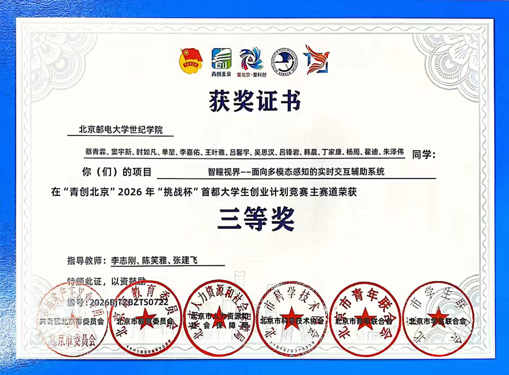

# 基于多智能体协作的供热运营数据查询与分析系统

> 本科毕业设计。以检索员、分析师、撰稿人、审核员四个智能体串行协作，面向供热企业运营管理场景，实现供热运营数据的自然语言查询、指标计算、统计分析、异常检测与报表生成。
>
> **命名说明**：毕业设计任务书上的题目是「基于多 Agents 的企业数据检索与分析系统的设计与实现」，本系统是其具体实现，领域收窄为**供热运营**（与任务书正文「基于 2025 年北京某供暖企业运营数据」一致）。论文封面与答辩材料以任务书题目为准。

## 竞赛获奖

本科期间在**供热智能化、大模型应用、多模态感知、机器视觉**等方向获学科竞赛奖项 **8 项**：一等奖 1 项、二等奖 3 项、三等奖 4 项。其中「**供热工控系统数据自然语言检索应用开发**」即本系统的赛题来源与前期成果。图片可直接预览，点击可查看原图。

<table>
<tr>
<td align="center" width="50%">
<a href="assets/awards/2026_青创北京挑战杯首都大学生创业计划竞赛_三等奖_智瞳视界.jpg"></a><br>
<sub><b>「青创北京」2026 年「挑战杯」首都大学生创业计划竞赛</b> · 主赛道 <b>三等奖</b><br>作品：智瞳视界——面向多模态感知的实时交互辅助系统</sub>
</td>
<td align="center" width="50%">
<a href="assets/awards/2026-06_首届世纪杯大学生智能体开发与应用创新大赛_二等奖_邮院守则小管家.jpg"></a><br>
<sub><b>首届「世纪杯」大学生智能体开发与应用创新大赛</b> · <b>二等奖</b><br>作品：邮院守则小管家（团队队长） ｜ 2026.06</sub>
</td>
</tr>
<tr>
<td align="center" width="50%">
<a href="assets/awards/2026-05_第八届北京市节能节水低碳减排竞赛_三等奖_碳智通.jpg"></a><br>
<sub><b>第八届北京市大学生节能节水低碳减排社会实践与科技竞赛</b> · <b>三等奖</b><br>作品：碳智通——开源大模型驱动的「双碳」政策与企业智能问答系统 ｜ 2026.05</sub>
</td>
<td align="center" width="50%">
<a href="assets/awards/2026-01_首届北京市大学生人工智能＋创新大赛_三等奖_遥感图像智能分类.jpg"></a><br>
<sub><b>首届北京市大学生「人工智能＋」创新大赛</b> · 产智融合应用赛 <b>三等奖</b><br>赛项：远观万象·遥感图像智能分类 ｜ 2026.01</sub>
</td>
</tr>
<tr>
<td align="center" width="50%">
<a href="assets/awards/2025-12_北京市大学生人工智能＋创新大赛校赛_一等奖_青宇观澜.jpg"></a><br>
<sub><b>北京市大学生「人工智能＋」创新大赛 · 校级赛</b> · <b>一等奖</b><br>团队：青宇观澜 ｜ 2025.12</sub>
</td>
<td align="center" width="50%">
<a href="assets/awards/2025-11_华北五省计算机应用大赛校赛_二等奖_云武智评.jpg"></a><br>
<sub><b>2025 华北五省（市、自治区）及港澳台大学生计算机应用大赛 · 校级赛</b> · <b>二等奖</b><br>团队：云武智评（团队组长） ｜ 2025.11</sub>
</td>
</tr>
<tr>
<td align="center" width="50%">
<a href="assets/awards/2025-05_第七届北京市节能节水低碳减排竞赛_三等奖_供热工控系统数据自然语言检索.jpg"></a><br>
<sub><b>第七届北京市大学生节能节水低碳减排社会实践与科技竞赛</b> · <b>三等奖</b><br>作品：<b>供热工控系统数据自然语言检索应用开发</b>（本系统赛题来源）｜ 2025.05</sub>
</td>
<td align="center" width="50%">
<a href="assets/awards/2023-11_华北五省计算机应用大赛_本科组二等奖_基于机器视觉的智慧生产车间系统.jpg"></a><br>
<sub><b>「中空信达杯」2023 年华北五省（市、自治区）及港澳台大学生计算机应用大赛</b> · 本科组 <b>二等奖</b><br>作品：基于机器视觉的智慧生产车间系统的设计与实现 ｜ 2023.11</sub>
</td>
</tr>
</table>

## 仓库说明（首次克隆先看这段）

本仓库 `MOA-EQAS` 只包含**代码与文档**。以下几类内容因体积或安全原因**不在仓库里**（已在 `.gitignore` 中排除），需要自行准备：

| 不在仓库 | 说明 | 怎么补 |
|---|---|---|
| `documents/` | 四套数据资产，约 **5GB**（业务运营报表、热泵住户实测、换热站 SCADA、气象），外加 `05_standards/` 下 6 份规范摘要 | 按 **§6.1** 的目录结构放入对应文件；缺规范摘要也能跑，只是知识库里没有条文 |
| `.env` | 含真实数据库口令与大模型 API Key | `cp .env.example .env` 后按 **§十一** 填写 |
| `models/bert-base-chinese` | 本地向量模型（约 400MB） | 见 **§9.2** 前置准备（用 `EMBEDDING_LOCAL_DIR` 指向本机已有目录） |
| `milvus_data/` | 本地向量库文件 | 跑一次 `python document_processor.py --ingest` 自动生成 |

准备好后，按 **§9.3**（本机直接跑）或 **§9.2**（Docker Compose）启动即可。

---

# 一、课题背景与系统定位

供热系统是城市基础设施的重要组成部分，其智能化、高效化运行是提升居民生活质量、实现节能减排目标的关键。供热工控系统在运行过程中积累了大量运营数据，蕴含丰富信息，但传统的数据检索与分析方法依赖专业人员，操作复杂、难以快速响应。

随着大语言模型与多智能体技术的发展，利用自然语言完成高效的数据检索与统计分析成为可能。本系统基于多智能体协作框架构建，将供热领域的专业术语、指标口径与运营数据、气象数据、工控时序数据统一纳入可对话的分析入口：

- **面向用户**：供热企业内部运营管理及专业人员
- **数据基础**：供热运营能耗与热费收缴数据、住户级热泵实测数据、换热站 SCADA 运行数据、气象观测数据、《数据及计算说明》中的指标定义与计算公式、现行供热国家标准
- **协作机制**：检索员 → 分析师 → 撰稿人 → 审核员，串行协作并带审核反馈闭环
- **目标**：降低专业人员依赖，提升供热运营智能化管理水平

依据赛题《命题 2·基于大语言模型的供热工控系统数据自然语言检索和统计分析应用开发》及《文件说明》——「依据供热运营记录，通过大模型查询《数据及计算说明》中任意已定义的数据」。

# 二、系统功能

| 功能 | 说明 |
|------|------|
| 自然语言查询 | 用户以自然语言提问，系统解析供热术语与查询意图 |
| 意图结构化 | 解析出「指标 / 层级 / 日期 / 口径」四要素，并识别居民/非居民分类诉求 |
| 指标计算 | 按《数据及计算说明》计算气耗、水耗、电耗、收费率等指标，含评价值、环比、累计与度日数折标 |
| 统计分析 | 趋势分析、多项目横向对比、站级工况、分户画像、温度归一化 |
| 异常检测 | 指标越限、突变、数据缺失、工况偏离（4 类算法） |
| 报表生成 | 自动生成图文报告与可视化图表 |
| 站级工况分析 | 基于 SCADA 时序的供回水温度、温差与室外温度关联分析 |
| 分户能效分析 | 基于热泵实测数据的分户能耗画像与热泵能效评估 |
| 口径校验 | 审核员以 10 项确定性规则校验公式、单位、层级归属、居民/非居民口径与引用准确性，不通过则反馈重算 |
| 横向对比面板 | 报告之外单列多项目排名（表格 + 条形图） |
| 异常检测面板 | 报告之外单列异常列表（严重度 + 类型 + 时间 + 详情） |
| **思考过程实时流** | 运行期间在右侧主区滚动呈现四个角色的思考过程（意图解析、知识库命中、逐条指标与公式、报告分节、逐项审核结论），模型写的文字**逐字吐出**；跑完后报告接在其下方（见 §12.4） |
| 按角色配置模型 | 四个智能体可分别指定模型，界面逐行显示各角色实际使用的模型（见 §11.1、§12.3） |

## 2.1 查询维度

- **层级**：项目级 / 公司级 / 集团级
  - 项目级：公司A 项目 1–8
  - 公司级：公司A = 公司A 项目 1–8 之和
  - 集团级：集团 = 公司A + ……
- **时间**：指定日期、日期区间、采暖季（含标准采暖季）
- **口径**：日值 / 累计值 / 评价值 / 环比 / 度日数折标
- **分类**：居民 / 非居民

> 注：度日数类数据仅需计算到集团级、公司级；其他数据均需计算到集团级、公司级、项目级。收费数据各项均需统计到集团级、公司级、项目级。

## 2.2 数据域分流（实现要点）

四类问题必须先分流到对应数据域，否则「换热站温差」会被当成公司级指标查询、「国家标准要求」会被当成指标计算，答案会答非所问。

| 领域 `domain` | 触发线索 | 处理路径 |
|---|---|---|
| `enterprise` | 有能源/收费指标词 | `indicators` 取 MySQL 计算（+ 多项目时横向对比） |
| `scada` | 换热站、`L4` 等编号、供回水、二次侧 | `analytics.scada_analysis` |
| `household` | 住户、分户、热泵、能效 | `analytics.household_analysis` |
| `weather` | 气象、温度站、室外温度 | `analytics.weather_trend` |
| `knowledge` | 国家标准、规范、条文、要求 | 知识库检索 |

# 三、多智能体协作设计

## 3.1 角色分工

系统设检索员、分析师、撰稿人、审核员四个智能体。**意图解析归入检索员的第一步动作，不另设独立角色**，以保持任务链简洁、责任边界清晰。

| 角色 | 在供热系统里的职责 | 实际调用的模块 |
|------|-------------------|--------------|
| **检索员**（供热数据检索） | 先解析用户意图（指标/层级/日期/口径），再从能耗表、收费表、计算说明、气象与 SCADA 数据中取数据与公式；确定数据域 | `intent_parser`、`MilvusStorage` |
| **分析师**（供热指标核算） | 按《数据及计算说明》计算指标值、评价值、环比、累计、度日数折标，做趋势/异常判断，做站级与分户维度分析；末尾可选地用模型写一段**结果解读**（只解释已有数字，单独成节、不参与任何数值） | `indicators`、`analytics`（+ 可选 `llm_client`） |
| **撰稿人**（供热报告撰写） | 把结果组织成规范回答/报告（含数据、结论、来源、口径说明） | `report_generator`（+ 可选大模型综述） |
| **审核员**（供热口径校验） | 校验公式、单位、层级归属、居民/非居民口径、引用是否准确；不通过则反馈重算 | 确定性规则 + 可选大模型定性审查 |

> 四个角色的结构由 `Agent` 基类统一约定：基类收口「是否启用大模型」与「调大模型」（`Agent.ask`，含失败降级），子类只声明自己的 `name` / `role` / `role_key` 并实现 `run`。

## 3.2 协作流程

```
用户提问
   │
   ▼
┌─────────────┐   context    ┌─────────────┐   context    ┌─────────────┐   context    ┌─────────────┐
│   检索员     │ ───────────▶ │   分析师     │ ───────────▶ │   撰稿人     │ ───────────▶ │   审核员     │
│ Retriever   │              │  Analyst    │              │   Writer    │              │  Reviewer   │
└─────────────┘              └─────────────┘              └─────────────┘              └──────┬──────┘
                                                                                             │
                                                              不通过：反馈重算 ◀─────────────┤
                                                                                             │
                                                                        通过：输出回答 ◀──────┘
```

编排器（`AgentOrchestrator.run_task`）以 `context` 逐级传递上下文，将每个环节的中间结果与执行状态通过流式回调推送前端，经 SSE 实时呈现。**审核不通过时带着审核意见重算，`MAX_REVIEW_ROUNDS = 2`（即首轮 + 最多 2 轮重算）；仍未通过则如实标注未通过项，不伪装成通过。**

## 3.3 审核员的校验项（实现要点）

审核以**确定性规则**为主（可测、可复现），大模型只做补充性定性审查（`_llm_review`，**只补充意见，不改变确定性结论**，受 `use_llm` 控制）。共 **10 项**，其中若干项**真实回查数据库**，不是形式检查：

| # | 校验项 | 判据 |
|---|---|---|
| 1 | **分析执行** | 分析师必须产出核算/统计结果，或显式声明为什么没产出（防「静默空转」） |
| 2 | 公式依据 | 每个已算出的指标都必须标注所用公式 |
| 3 | 单位标注 | 除比率类外必须有单位 |
| 4 | 不可用项说明 | 取不到数的指标必须给出原因，**不允许静默缺失** |
| 5 | 居民/非居民口径 | 收费类问题必须指定分类（或明示取小计） |
| 6 | 本季/旧欠口径 | 明确区分，避免口径混淆 |
| 7 | 引用来源 | 报告只要有正文就必须列出数据来源 |
| 8 | **层级归属** | **各项目之和 = 公司合计**（真实回查 `fact_energy_daily` 核对耗量与面积，容差 0.5%） |
| 9 | **收费率重算一致性** | 按公式重算的值与报表原值对照，偏差超 0.5pp 标记不一致 |
| 10 | **模型生成内容标注** | 大模型生成的文字必须单独成节并显式标注「模型生成」，不得并入「结论」等确定性分节 |

评分规则：`quality_score = max(0, 100 − 15 × 不通过项数)`。

## 3.4 问答示例

**例 1：公司A 今日气耗指标及环比**

> 问题：公司A 今天的气耗指标是多少？和昨天比有什么变化？

| 环节 | 角色 | 这一步干什么（含真实数据） |
|------|------|---------------------------|
| ① | 检索员 | 解析意图 = 气耗·公司A·日值·指标与环比；取《运营能耗-公司A》日气耗量 789659.5 Nm³、总供热面积 11529258.6 m²；取公式「日气耗指标 = 日气耗量 / 面积」 |
| ② | 分析师 | 算日气耗指标 ≈ 789659.5 ÷ 11529258.6 ≈ 0.06849 Nm³/m²；评价值 = 0.06849 × 121 ≈ 8.29；环比 =（当日 − 昨日）/ 昨日 |
| ③ | 撰稿人 | 输出「公司A 今日气耗指标 0.0685 Nm³/m²，较昨日环比 ±X%」，标注来源与评价等级 |
| ④ | 审核员 | 校验公式按说明、单位 Nm³/m² 正确、层级用合计、未混淆居民/非居民；通过则输出，不通过反馈重算 |

> 实测：日气耗指标值 = **0.068492**、评价值 = **8.287506**（与上述完全吻合）；环比因**库中仅单日快照**而返回「不可用：缺少上一日数据」——系统如实说明，不编造。

**例 2：项目 3 本季收费率（居民 / 非居民）**

> 问题：项目 3 的本季收费率是多少？居民和非居民分别是多少？

> 实测：小计 75.0956% / 居民 77.6919% / 非居民 67.9187%（公司A 口径），全部与报表一致。项目2/3/8 当期无数据，系统会**点名说明**并列出库中真正有数据的实体。公司级收费率按户数加权，与项目级不采用同一口径 —— 详见 §4.3。

**例 3：度日数折标后的能耗对比**

> 问题：把公司A 今天的日气耗做度日数折标，和上周同期比一下。

> 实测：折标后日气耗指标值 = **0.071955**（温度源为演示站点 `8jB`）；同时把「和上周同期比」标为**当前数据不支持的周比口径**，如实说明而非编造。

**例 4（工况类）：换热站供回水温差是否正常**

> 问题：L4 换热站昨天的二次侧供回水温差正常吗？

> 实测（`L4`）：18,101 个时段，温差均值 4.82℃、范围 [−42.7, 33.3]℃；**二次侧供水温度与室外温度的相关系数 −0.9216**，判定「符合正常运行调节特性」；温差越界 4,398 时段（24.3%）。

**例 5（规范类）：居民室内供暖温度**

> 问题：国家标准规定居民室内供暖温度是多少？低于标准怎么办？

> 实测：命中 GB 50736 与 GB/T 33833，答复给出 **18℃～24℃**、室温不达标的核减热费与服务依据、测温程序；并如实说明「给定条文未规定统一的运行阶段达标判定数值」。系统只在检索到条文时才作答，**不让大模型凭记忆编造标准号**。

> **两个混合型示例的实测补充**：①「供热管网运行时回水压力有什么安全要求？」命中 GB 55010（全文强制），答复给出**任何一点回水压力 ≥50kPa**、泵吸入侧 ≥汽化压力+50kPa、保持定压；②「公司A本季收费率75%，算不算达标？」企业域算出 75.1%（户数口径校验 0.0000pp），**并补上规范依据**：明确标准未规定收费率达标数值、应与企业目标值/历史同期比较，**未臆造任何达标阈值**。

# 四、指标体系与计算口径

以下口径依据《数据及计算说明》，实现于 `indicators.py`。

## 4.1 日期

| 指标 | 公式 |
|------|------|
| 发生责任日期 | = 计算日 − 1 |
| 日报日期 | = 发生责任日期 + 1 = 计算日 |
| 已供暖天数 | = 计算日 − 供热开始日期（**供热开始日期为设定口**） |
| 法定已供暖天数 | = 计算日 − 法定正式供热日期（11-15） |

## 4.2 能耗（气耗 / 水耗 / 电耗）

输入来源：各单位「运营能耗」表。输入数值：面积、日耗量、累计耗量。

**日值**

```
日耗指标值 = 日耗量 / 面积
日耗评价值 = 日耗指标值 × 121
日耗指标值环比 =（当日 − 昨日）/ 昨日
日耗评价值环比 =（当日 − 昨日）/ 昨日
```

**累计值（非标准采暖季）**

```
累计耗指标值 = 累计耗量 / 面积
累计耗评价值 = 累计耗指标值 / 已供暖天数 × 121
```

**标准采暖季累计**

```
标准采暖季累计耗指标值 =（当前累计耗量 − 11月14日累计耗量）/ 面积
标准采暖季累计耗评价值 = 标准采暖季累计耗指标值 / 法定已供暖天数 × 121
```

**度日数折标**

```
度日数折标后日耗量 = 日耗量 × (18 + 0.7) / (18 − 当天室外平均温度)
度日数折标后累计耗量 = 累计每日的度日数折标后日耗量
度日数折标后日耗指标值 = 度日数折标后日耗量 / 面积
度日数折标后累计耗指标值 = 累计每日的度日数折标后日耗指标值
```

- 公司级温度选取规则：公司A 取大兴城区温度，其他同规则。
- 集团级规则：在耗量步骤时，各单位按对应温度计算，加和成集团级耗量总数，再做后续计算（实现于 `_group_energy_result`）。
- 实现说明：折标公式依赖「当天室外平均温度」。系统以气象数据作为温度输入源；当前因缺少真实的大兴城区温度，暂用 HEAPO 匿名站点（`is_demo=True`，标记为演示/替代）作为温度源。

## 4.3 热费收缴

输入来源：各单位「热费收缴」表。输入、输出数值为该表所有数据，**保留居民、非居民的分类**。

- 本季收费率 = 累计本季实收 / 本季应收 × 100%
- 需区分「本季」与「旧欠」，避免口径混淆
- **收费面积与供热面积不一致，需注意做好区分**
- ⚠️ **公司级与项目级采用不同聚合口径**：

  | 层级 | 报表公式（源表原式） | 口径 |
  |---|---|---|
  | 项目级 | `E38 = E29*100/E11` 即「累计本季实收金额 ÷ 本季应收金额 × 100%」 | 金额口径 |
  | 公司级 | `D37 = (E37*E7+F37*F7+…)/SUM(E7:L7)`，权重取第 7/8/9 行「本季应收户数」 | **户数口径** |

  按各自口径复算，**17 个「实体 × 分类」组合全部 0.0000pp 一致**。因此公司级收费率**不等于**各项目收费率的简单平均，也不等于公司级金额之比（非居民因户数少且分布悬殊，两种口径相差约 1.8 个百分点）。

> 实现说明：报表原值取自查询，同时按上式重算并进行对照（`_fee_rate_cross_check`，容差 `RATE_TOLERANCE=0.5pp`）。**这一口径差异是由「审核员」的重算校验环节发现的**，可作为多智能体审核机制有效性的实例。

## 4.4 数据条件带来的口径限制

以下限制不是缺陷，而是数据条件所限；系统一律**如实返回「不可用 + 原因」**，不猜测、不编造：

| 限制 | 影响的口径 | 原因 |
|---|---|---|
| 企业运营数据仅单日快照（`2023-12-16`） | 日指标环比、标准采暖季累计、**企业域异常检测** | 缺多日序列 |
| `HEATING_START_DATE=2023-11-07` 为假定值 | 「已供暖天数」与「法定已供暖天数」目前都是 31 天，两个口径看不出差别 | 真实供热开始日期未知，改 `.env` 即可 |
| 气象站点为匿名化编号（`8jB` 等） | 度日数折标所用温度源 | 无地理位置、非本项目实测区域，仅作演示/替代 |
| `documents/01_business_data/` 中项目 2、3、8 当期无数据 | 相关实体查询 | 维度表登记了但事实表无数据；系统会点名并列出真正有数据的实体 |
| `documents/05_standards/` 为**条文摘要**（非官方全文） | 规范引用 | 标准编号与名称取自课题资料，正式引用前须核对现行版本；⚠️ 国标全文有版权，建议保持「摘要 + 出处」形式 |
| SCADA 温差合理区间为工程经验值（3~25℃，可配置） | 站级工况异常判定 | 应按各站实际工况标定后使用 |

# 五、系统架构

## 5.1 总体架构

```
┌───────────────────────────────────────────────────────────────────────┐
│                 Nginx（部署时，SSE 关闭缓冲） + Flask 应用               │
├───────────────────────────────────────────────────────────────────────┤
│  Agent App (Flask + RESTful + SSE)                                    │
│   检索员 ──▶ 分析师 ──▶ 撰稿人 ──▶ 审核员                                │
│   意图解析     指标计算     报表生成     口径校验                        │
│   +知识检索    +统计分析     +图表规格    +反馈重算                      │
├───────────────────────────────────────────────────────────────────────┤
│  Milvus 向量库（规范与计算说明等文本知识）  │  MySQL（运营指标/收费/       │
│  开发: Milvus Lite 本地文件               │  气象/SCADA/分户时序）       │
│  部署: etcd + MinIO + Milvus 2.3.5        │  12 张表 / 2,352,318 行     │
└───────────────────────────────────────────────────────────────────────┘
                    ▲
                    │ 数据接入（ETL，heat_db.py）
        documents/ 四类数据资产：业务数据 · 热泵实测 · SCADA · 气象/参考
```

系统分四层：

1. **接入层**：Nginx 反向代理（SSE 关闭缓冲）、前端交互界面
2. **服务层**：Flask 提供 RESTful 与 SSE 接口；多智能体编排器承载业务推演
3. **能力层**：供热意图解析、指标计算、统计分析、异常检测、报表生成、知识检索
4. **数据层**：Milvus 向量库（规范与计算说明等文本知识）+ MySQL 关系库（运营指标、收费、气象、SCADA、分户时序）

## 5.2 功能模块

| 模块 | 文件 | 职责 |
|------|------|------|
| 接口层 | `api_server.py` | RESTful 路由、SSE 流式推送、CORS、统一错误处理、前端静态资源 |
| 意图解析 | `intent_parser.py` | 数据域分流、供热术语识别、指标/层级/日期/口径抽取、居民非居民分类、环比/同比/周比识别 |
| 知识检索 | `document_processor.py` | 递归多格式解析、清洗分片、向量化、Milvus 增删查 |
| 指标计算 | `indicators.py` | 日期口径、气/水/电耗指标、评价值、环比、累计、标准采暖季累计、度日数折标、集团级聚合；收费率与重算校验 |
| 统计分析 | `analytics.py` | 趋势、多项目对比、异常检测（越限/突变/缺失/工况偏离）、站级工况、分户画像 |
| 报表生成 | `report_generator.py` | 报告文本 + 图表规格装配（含来源与口径说明） |
| 智能体编排 | `multi_agents.py` | 四智能体串行编排、上下文传递、审核反馈闭环、流式回调、补充面板归一化 |
| 数据访问 | `heat_db.py` | 业务数据 ETL 入库、时序数据查询、气象站点映射与折标温度取数 |
| 模型接入 | `llm_client.py` | 对话模型与向量模型接入（OpenAI 兼容 / Ollama / 本地），**按角色取模型**（`get_llm(role)`） |
| 配置 | `config.py` | 集中配置（数据库 / 向量库 / 模型 / 供热业务参数 / 阈值） |
| 前端 | `web/` | 原生 ES Module，无框架无图表库（手写 SVG） |

## 5.3 服务清单（部署形态，`docker-compose.yml`）

**7 个服务**，依赖链完整（milvus ← etcd + minio；init-data / agent-app ← mysql + milvus 健康；agent-app ← init-data `service_completed_successfully`；nginx ← agent-app）：

| 服务 | 镜像 | 端口 | 说明 |
|------|------|------|------|
| `mysql` | mysql:8.0 | 3306 | 关系库（healthcheck） |
| `etcd` | quay.io/coreos/etcd:v3.5.5 | — | Milvus 元数据存储（healthcheck） |
| `minio` | minio/minio | — | Milvus 对象存储（healthcheck） |
| `milvus-standalone` | milvusdb/milvus:v2.3.5 | 19530 / 9091 | 向量数据库（healthcheck） |
| `init-data` | build `.` | — | 一次性初始化：`heat_db.py --init --load all` + `document_processor.py --ingest` |
| `agent-app` | build `.` | 5000 | 主应用（Flask + RESTful + SSE + 前端静态资源） |
| `nginx-proxy` | nginx:1.25-alpine | 80 | 反向代理，挂载 `./nginx.conf`（SSE 关闭缓冲） |

数据卷：`mysql-data` / `etcd-data` / `minio-data` / `milvus-data` / `app-uploads`；网络：`milvus` + `app`。

> 开发阶段**不使用 Docker**：关系库用本机 MySQL，向量库用 Milvus Lite 本地文件。

# 六、数据资产与利用方案

## 6.1 `documents/` 目录结构

按「数据用途」分五类，前缀数字表示阅读顺序；目录名用 ASCII（便于容器与脚本跨平台引用），业务数据文件名保留中文（与《数据及计算说明》等文档引用一致）。

```
documents/
├── 01_business_data/                        # 运营业务数据（企业侧）
│   ├── 运营能耗-公司A.xlsx                   # 集团运营能耗日报表
│   ├── 热费收缴-公司A.xlsx                   # 集团热费收缴日报表
│   └── 数据及计算说明.docx                   # 指标定义与计算公式
│
├── 02_heapo_heatpump/                       # 热泵住户实测数据（5,282 个文件）
│   ├── meta_data/                           # 住户问卷元数据（households / meta_data / meta_data_variables）
│   ├── reports/                             # 上门勘查报告（protocols.csv 106 列 + 变量字典）
│   ├── smart_meter_data/                    # 智能电表时序（按 Household_ID 分文件）
│   │   ├── 15min/               (1,407 个，约 4.8GB —— 不入库，按需读取)
│   │   ├── daily/ (1,298) · monthly/ (1,264) · cumulative_counters/ (1,285)
│   │   ├── overview/            (可用性概览)
│   │   └── smart_meter_variables.csv        # 电表字段字典（本项目整理，58 列）
│   └── weather_data/                        # 气象观测（按 Weather_ID 分文件）
│       ├── daily/ (8) · hourly/ (8) · overview/ (变量字典 + 可用性表)
│
├── 03_xai4heat_scada/                       # 换热站 SCADA 运行数据
│   ├── xai4heat_heating_area.csv            # 各换热站供热面积
│   └── xai4heat_scada_L{4,8,12,17,22}_processed.csv
│
├── 04_reference/                            # 外部对照数据
│   ├── nyc_heating_gas_2010_2025.csv        # 纽约市建筑供暖燃气消耗与费用
│   └── beccs_dataset_information.pdf        # BECCS 数据集说明
│
└── 05_standards/                            # 6 份国家/行业标准条文摘要（自动入库）
```

## 6.2 数据集说明

**① `01_business_data/` — 运营业务数据**

| 文件 | 内容 | 关键字段 |
|------|------|---------|
| `运营能耗-公司A.xlsx` | 集团运营能耗日报表，16 项 ×（合计 + 项目 1–8） | 总供热面积、居民/非居民供热面积、日气耗量、单平米日气耗指标、累计气耗量、日电耗量、累计电耗量、日水耗量、累计水耗量及对应指标 |
| `热费收缴-公司A.xlsx` | 集团热费收缴日报表，13 项 ×（合计 + 项目 1–8），均分小计/居民/非居民 | 本季收费面积、本季应收户数、本季应收金额、旧欠应收金额、日/累计本季实收户数、日/累计本季实收金额、户缴率、本季收费率、旧欠收费率 |
| `数据及计算说明.docx` | 各项指标的定义与计算公式 | 日期、能耗（气耗/水耗/电耗）、热费收缴 |

**② `02_heapo_heatpump/` — 热泵住户实测数据**

以 `Household_ID` 与 `Weather_ID` 为关联主键组织：

| 子目录 | 内容 | 主键 |
|--------|------|------|
| `meta_data/` | 住户问卷元数据（建筑面积、热泵类型、供热末端、生活热水方式、是否光伏等） | Household_ID |
| `reports/` | 上门勘查报告（建筑类型、建造年代、围护结构改造、分层供暖面积、热泵型号等） | Report_ID / Household_ID |
| `smart_meter_data/` | 智能电表时序，按采样分辨率分 15min / daily / monthly / cumulative_counters 四类，另含各分辨率的可用性概览 | Household_ID + Timestamp |
| `weather_data/` | 气象观测，按 daily / hourly 两种分辨率，含变量字典与可用性表 | Weather_ID + Timestamp |

- 电表字段：`kWh_received_Total`、`kWh_received_HeatPump`、`kWh_received_Other`、`kWh_returned_Total`、`kvarh_received_capacitive_*` 等。
- 气象字段：气温（小时均/日均/日最高/最低）、**SIA 与 US 两种供暖度日数**、US 供冷度日数、露点、湿度、降水、气压（QFE/QNH/QFF）、日照时长、风速。
- ⚠️ `kWh_received_HeatPump` 在本数据集中**仅约 3.8% 的行有值**（72,594/1,904,076），"热泵单独耗电"多数住户不可得；字段说明里给了无值时的替代口径（改用 `kWh_received_Total` 并注明）。

**③ `03_xai4heat_scada/` — 换热站 SCADA 运行数据**

5 个换热站（L4、L8、L12、L17、L22）的逐小时运行数据。字段：`datetime`、`t_amb`（室外温度）、`t_ref`、`t_sup_prim` / `t_ret_prim`（一次侧供/回水温度）、`t_sup_sec` / `t_ret_sec`（二次侧供/回水温度）、`delta_e`（累计热量读数增量）。

**④ `04_reference/` — 外部对照数据**

| 文件 | 内容 | 用途 |
|------|------|------|
| `nyc_heating_gas_2010_2025.csv` | 纽约市建筑供暖燃气消耗与费用（约 24.9 万条账单记录） | 外部对照 |
| `beccs_dataset_information.pdf` | BECCS（Bremen Energy Consumption Catalogue for Six Years）数据集说明 | 外部对照（德国不来梅市 88,901 栋建筑 2016–2021 年能耗） |

> ⚠️ `beccs_dataset_information.pdf` 描述的是 BECCS（不来梅）数据集，与 `02_heapo_heatpump/`（热泵实测数据）**并非同一数据集**，两者无文档对应关系。该 PDF 仅作外部方法学参考。

## 6.3 数据利用方案

四套数据在系统中各有不可替代的位置，分别支撑不同层级的分析能力。

| 数据集 | 粒度 | 系统能力 | 接入方式 |
|--------|------|---------|---------|
| `01_business_data` | 项目/公司/集团级 · 日 | 核心运营指标体系：气/水/电耗指标值、评价值（×121）、环比、累计、标准采暖季累计；收费率与户缴率（居民/非居民） | Excel 解析入库，按「指标 × 层级 × 日期」建事实表 |
| `02_heapo_heatpump` | 住户级 · 15min/日/月/累计；气象站级 · 逐时/逐日 | ① 分户能耗画像、热泵能效评估、建筑类型与建造年代对比；② **为度日数折标与能耗温度归一化提供室外温度与现成的 SIA/US 供暖度日数** | 分分辨率/日粒度批量导入；气象按 Weather_ID 导入并建立住户/公司—站点映射 |
| `03_xai4heat_scada` | 换热站级 · 逐小时 | 站级工况分析：一/二次侧供回水温度、温差、二次侧供水温度随室外温度的调节特性、水力失调与异常工况检测 | 按 substation_id 导入站级时序表，与供热面积表关联 |
| `04_reference` | 建筑级/年 | 外部对照基准，用于横向对比与方法学参考 | 按需加载，不进入核心指标链路 |

### 三处关键融合（已实现，非纸面设计）

1. **气象数据 → 度日数折标与温度归一化。** 4.2 节的折标公式需要「当天室外平均温度」，气象数据集提供逐日气温与**预计算的 SIA 供暖度日数**。系统据此为公司/项目配置温度站点映射，使折标结果可复核；进一步地，在住户能耗异常检测中用**单位度日数用电量（kWh/℃·日）**剔除季节性 —— 否则对强季节性的供热用电直接套「均值 ± kσ」会把每个采暖季高峰都判成异常。
2. **SCADA 数据 → 站级工况与异常检测。** 一/二次侧供回水温度与 `delta_e` 构成站级水力工况的完整观测。据此可计算供回水温差、二次侧供水温度随 `t_amb` 的调节曲线（实测相关系数 **−0.9216**，符合正常运行特性），并结合各站供热面积判断单位面积供热量与水力失调风险。
3. **热泵住户数据 → 分户能效与建筑维度对比。** 分户电表数据与问卷/勘查元数据关联后，可支撑「不同建造年代/末端形式的热泵能耗差异」「分户能耗异常户识别」等分析，为运营指标提供住户级下钻视角。

### 入库表设计（已落地于 `heat_db.py`）

| 表 | 主键/维度 | 来源 | 行数 |
|----|----------|------|------|
| `dim_entity` | 层级、公司、项目 | 业务数据表头 | 10 |
| `fact_energy_daily` | 实体、日期、指标 | `运营能耗-公司A.xlsx` | 90 |
| `fact_fee_season` | 实体、日期、项目、分类 | `热费收缴-公司A.xlsx` | 231 |
| `fact_daily_note` | 公司、日期、报表类型、段落 | 两张报表的标题/动态/注释原文 | 16 |
| `dim_weather_station` | Weather_ID、公司映射、`is_demo` | `weather_data/overview/` | 8 |
| `fact_weather_hourly` / `_daily` | Weather_ID、时间戳 | `weather_data/hourly`、`daily` | 362,112 / 15,083 |
| `dim_household` | Household_ID、建筑与热泵属性 | `meta_data/` | 1,408 |
| `fact_household_protocol` | Report_ID、Household_ID | `reports/` | 410 |
| `fact_household_meter` | Household_ID、分辨率、时间戳 | `smart_meter_data/`（不含 15min） | 1,904,076 |
| `dim_substation` | substation_id、供热面积 | `xai4heat_heating_area.csv` | 5 |
| `fact_scada_hourly` | substation_id、时间戳 | `xai4heat_scada_L*.csv` | 68,869 |

# 七、知识库构建

知识库由「计算规则 + 专业规范 + 数据字典」构成，经**递归**文档预处理流水线（解析 → 清洗 → 分片 → 向量化）入向量库：

1. **计算规则**：《数据及计算说明》中的指标定义与计算公式 —— 问答时用于取公式与校验口径
2. **专业规范**：6 份现行国家标准/行业标准**条文摘要**（`documents/05_standards/`，随 `--ingest` 自动纳入）
3. **数据字典**：`meta_data_variables.csv`、`protocols_variables.csv`、`weather_variables.csv`、`smart_meter_variables.csv` 等变量说明，使系统理解各字段业务含义
4. **运营与观测数据**：结构化数据入关系数据库供指标计算取数；文本类知识入向量库供语义检索

预处理流水线支持 `.pdf` / `.docx` / `.xlsx` / `.csv` / `.txt` / `.md` / `.json`，并**递归遍历** `documents/` 各子目录。

> **重要边界**：5,282 个住户电表 CSV（约 4.8GB）与气象/SCADA 时序**不走向量库** —— 它们已在 MySQL 中，由指标计算与统计分析直接取数。知识源只含小体积的文本知识。

**当前知识库内容**（`document_processor.py` 的 `_default_knowledge_paths`）：**14 个文档 / 111 个分片**

| 文档 | 分片 | 类别 |
|---|---|---|
| `01_business_data/数据及计算说明` | 4 | 计算规则 |
| `01_business_data/热费收缴-公司A` | 10 | 运营数据（表头与释义） |
| `01_business_data/运营能耗-公司A` | 6 | 运营数据 |
| `02_heapo_heatpump/meta_data/meta_data_variables` | 4 | 数据字典 |
| `02_heapo_heatpump/reports/protocols_variables` | 50 | 数据字典 |
| `02_heapo_heatpump/smart_meter_data/smart_meter_variables` | 14 | 数据字典 |
| `02_heapo_heatpump/weather_data/overview/weather_variables` | 5 | 数据字典 |
| `02_heapo_heatpump/weather_data/overview/weather_variables_availability` | 4 | 数据字典 |
| `05_standards/CJJT223-2014_供热计量系统运行技术规程` | 2 | 专业规范 |
| `05_standards/CJJT34-2022_城镇供热管网设计标准` | 2 | 专业规范 |
| `05_standards/GB50736-2012_民用建筑供暖通风与空气调节设计规范` | 2 | 专业规范 |
| `05_standards/GB55010-2021_供热工程项目规范` | 2 | 专业规范 |
| `05_standards/GBT33833_城镇供热服务` | 3 | 专业规范 |
| `05_standards/GBT50893_供热系统节能改造技术规范` | 3 | 专业规范 |

**检索质量实测**：Top-1 88.9%（16/18）、Top-3 94.4%；新增规范语料后命中率由 75% 提升到 92.9%。当前向量模型为 `bert-base-chinese`（非句向量模型，命中文档与非命中文档的相似度均值仅差 0.0105、区间有重叠），若需更高区分度可换 `bge-m3`（1024 维，需同步改 `EMBEDDING_DIM` 并重建集合）。

`tests/test_report_generator.py::TestSmartMeterDictionary` 会以真实表头为准校验电表字段字典**既无遗漏也无臆造列**，防止后续数据换版时悄悄漏字段。

# 八、技术栈

| 层次 | 技术选型 |
|------|---------|
| 后端服务 | Python 3.10 · Flask · flask-cors · RESTful + SSE 流式响应 |
| 多智能体 | 自研智能体框架（`Agent` 基类 + 工具封装 + 串行编排器 + 审核反馈闭环），非第三方 Agent 框架 |
| 大语言模型 | OpenAI 兼容接口；当前对接 AutoDL；支持切换本地 Ollama。**四个角色可分别指定模型**（`LLM_MODEL_<角色>`，留空回退全局 `LLM_MODEL`），实现于 `llm_client.get_llm(role)`，见 §11.1；**支持流式输出**（OpenAI 兼容与 Ollama 两条 SSE 解析路径），用于把模型文字逐字推到前端 |
| 文本向量化 | 三选一：OpenAI 兼容接口 / 本地 Ollama / **本地 transformers 模型**（当前用 `bert-base-chinese`，768 维，均值池化 + L2 归一化） |
| 向量检索 | 开发：Milvus Lite（本地文件，无需 Docker）；部署：Milvus 2.3.5（etcd + MinIO），内积相似度 + top_k |
| 关系数据库 | MySQL + SQLAlchemy + PyMySQL；数值列统一 `Double` |
| 数据处理 | pandas · openpyxl · python-docx · pypdf |
| 前端 | 原生 ES Module + 手写 SVG，**不引入任何前端框架与图表库**（离线可演示）；设计令牌化的浅/深两套配色 |
| 部署 | Docker 多阶段构建（Python 3.10 与开发环境对齐；依赖装在 `/app/deps` 经 `PYTHONPATH` 引入，不写死 site-packages 路径；**torch 从 PyTorch 官方 CPU 源安装**约 200MB；不装 milvus-lite）· Docker Compose 编排（MySQL + Milvus 服务端 + 一次性初始化 + 应用 + Nginx）· 非 root 运行 · `.dockerignore` 保证密钥与大数据目录不入镜像 · 详见 §9.2 |
| 测试 | 标准库 `unittest`：单元 + 集成共 **176 个用例**（含指标复算、收费率两级口径、审核规则正反两面、19 条路由、SSE 事件序列、合规性判定、角色→模型路由、思考过程流） |

# 九、运行与部署

## 9.1 环境要求

- Python >= 3.10（当前开发环境为 3.10.9）
- MySQL >= 8.0（本地开发）
- 本地向量模型目录（默认 `bert-base-chinese`，768 维）
- Docker >= 20.10 + Compose v2（仅部署阶段需要；Windows 建议装 **Docker Desktop**，需 WSL2 后端）

**三个必须遵守的运行约定**（Windows 环境）：

```bash
# ① 用 PYTHONPATH 注入项目根目录（不要用 python -I，它会切断 sys.path 导致 import 失败）
cd "D:/大四/毕业设计/基于多 Agents 的企业数据检索与分析系统"
PYTHONPATH="$PWD" python xxx.py

# ② Windows 控制台是 GBK，中文输出会乱码或抛 UnicodeEncodeError
#    各模块已在启动时 reconfigure(encoding="utf-8")；自己写临时脚本时也要照做

# ③ 输出重定向到文件时 stdout 会变成块缓冲，看不到进度
#    需要进度就用 python -u 或设置 PYTHONUNBUFFERED=1
```

**环境依赖的硬约束**：

1. `transformers` 必须是 **4.x**（5.x 要求 `torch>=2.6`，本机 torch 为 2.5.1，升级会报「requires the PyTorch library but it was not found」）。自洽组合：`transformers 4.57.6` + `tokenizers 0.22.2` + `huggingface-hub 0.36.2`。
2. `protobuf` 必须在 `>=5.26,<6`（`pymilvus 2.3.8` 生成的 pb2 代码依赖 `google.protobuf.runtime_version`）。
3. 数值列必须用 `Double`（曾用 4 字节 `float` 导致 789659.5 被截断为 789660）。

## 9.2 部署启动（Docker Compose）

### 前置准备

**① 装 Docker Desktop**（Windows 需开启 WSL2 后端）。验证：`docker --version` 与 `docker compose version` 都能输出版本。

> ⚠️ **WSL 网络模式必须是 NAT（默认）**。若 `%USERPROFILE%\.wslconfig` 里设了
> `[wsl2] networkingMode=mirrored`（镜像模式），**Docker Desktop 的宿主机端口发布会完全失效**：
> 容器能跑、`docker compose ps` 也显示端口已映射，但宿主机上没有任何进程监听，
> 浏览器打开 `http://localhost/` 只会显示「无法加载此页面」，`netstat` 也查不到监听。
> 实测确认：改回 `networkingMode=NAT` 后 `wsl --shutdown` 再重启 Docker Desktop 即恢复正常。
> 镜像模式是 WSL 与宿主共享 IP 的模式，有些人为让 WSL 内走代理而开启；
> 若确实需要它，就要接受 Docker 端口发布不可用（可改用宿主机方式运行，见 §9.3）。

**② 配置 `.env`**（compose 会直接读它做变量插值）：

```bash
cp .env.example .env      # 已有 .env 则跳过
```

至少确认这几项：

| 变量 | 说明 |
|---|---|
| `DB_PASSWORD` | MySQL root 口令（compose 默认 `123456`） |
| `LLM_BASE_URL` / `LLM_API_KEY` / `LLM_MODEL` | 对话模型接入 |
| `LLM_MODEL_RETRIEVER / _ANALYST / _WRITER / _REVIEWER` | 可选，按角色指定模型；留空回退 `LLM_MODEL` |
| **`EMBEDDING_LOCAL_DIR`** | **必填**（见下） |

**③ 指定向量模型目录（必填）**。镜像**不含**向量模型，靠 volume 挂载；compose 的默认值 `./models/bert-base-chinese` 是个空目录，所以必须指向本机已下载的模型：

```env
# Docker Desktop（Windows）
EMBEDDING_LOCAL_DIR=D:/HuanJing/huggingface_model/bert-base-chinese
# 若在 WSL 里直接跑 docker，改用挂载点形式
# EMBEDDING_LOCAL_DIR=/mnt/d/HuanJing/huggingface_model/bert-base-chinese
```

没配这个也能起来构建，但 `init-data` 会在第一步**明确报错退出**并打印该怎么改（不会留下一个查不出原因的坏容器）。

> **为什么用挂载而不是打进镜像**：模型约 400MB，挂载可避免重复占空间，也能保证容器与开发机用的是同一份模型——**知识库必须用与查询相同的向量模型构建**，两边不一致会导致检索结果错乱。

### 启动

```bash
docker compose up -d --build
docker compose ps
docker compose logs -f agent-app      # 看应用日志
docker compose logs init-data         # 看初始化（建表入库 + 构建知识库）
```

首次启动的顺序：`mysql`/`etcd`/`minio`/`milvus` 起来并通过健康检查 → `init-data` 建表、灌入四个数据域、构建知识库（**约 5～10 分钟，住户时序约 190 万行**）→ `agent-app` 启动 → `nginx-proxy` 就绪。

> **已实测验证（2026-11-02，Docker Desktop 29.9.2）**：全新构建 + `up` 后，7 个服务全部就绪；
> 关系库 12 表 235 万行；知识库 **14 文档 / 111 分片**（与 §9.3 的本地开发环境逐项一致）；
> 知识检索命中正确条文；`/indicators` 返回真实指标值；浏览器经 `http://127.0.0.1/` 可正常使用，
> 状态栏显示「模型 按角色：N 种」。

浏览器打开 **http://127.0.0.1/** 即为前端界面（与 API 同源，无跨域问题）。

> ⚠️ **用 `127.0.0.1` 而不是 `localhost`**。Windows 把 `localhost` 优先解析为 IPv6 的 `::1`，
> 而 Docker Desktop 在 NAT 模式下**宿主侧的 IPv6 端口转发不工作**（实测 `http://[::1]/` 连不上、
> `http://127.0.0.1/` 正常）。用 `localhost` 会看到「无法加载此页面」，但容器其实一切正常。

**预期服务清单**（`docker compose ps`，7 个）：

| 服务 | 端口 | 作用 |
|---|---|---|
| `nginx-proxy` | 80 | 反向代理（SSE 关闭缓冲） |
| `agent-app` | 5000（内部） | 后端 + 前端静态资源 |
| `milvus-standalone` | 19530 / 9091 | 向量库 |
| `mysql` | 3306（内部） | 关系库 |
| `etcd` / `minio` | — | Milvus 的元数据与对象存储 |
| `init-data` | — | 一次性初始化（跑完即退出，状态为 `Exited (0)`） |

### 常用操作

```bash
docker compose stop agent-app                     # 只停应用
docker compose up -d agent-app                    # 只重启应用
docker compose exec agent-app python -c "import requests;print(requests.get('http://localhost:5000/health').json())"   # 容器内探活
docker compose down                               # 停止并删除容器（数据卷保留）
docker compose down -v                            # 连数据卷一起删（下次 up 会重新初始化）
```

### 关于镜像与依赖

- **多阶段构建**：依赖在 builder 阶段装到 `/app/deps`，运行镜像只带依赖目录与代码；运行时通过 `PYTHONPATH=/app:/app/deps` 引入，**不写死 `python3.x/site-packages` 路径**，换 Python 版本也不会静默失效。
- **Python 3.10**：与开发机（3.10.9）对齐，避免解释器版本差异带来的隐性风险。
- **torch 从 CPU 源安装**：本地向量模型需要 `torch`，但默认源给的是 CUDA 版（2GB+），镜像里改为从 PyTorch 官方 CPU 源安装（约 200MB）。首次构建约 1.2GB，耗时几分钟属正常。
- **不装 `milvus-lite`**：部署连 Milvus 服务端，嵌入式 Lite 只在开发机用；代码里也没有直接 import 它。
- **密钥不进镜像**：`.dockerignore` 排除 `.env`，密钥只在运行时由 compose 注入。
- **非 root 运行**：容器以 `appuser`（uid 10001）运行；`uploads/` 在镜像内就建好并归属该用户，命名卷首次挂载会继承这份属主，因此上传功能可正常写入。
- **离线向量模型**：镜像设了 `HF_HUB_OFFLINE=1` / `TRANSFORMERS_OFFLINE=1`，避免加载本地模型时还会去连 HuggingFace。

### 排查

| 现象 | 原因 | 处置 |
|---|---|---|
| `init-data` 立刻退出并提示「向量模型目录为空」 | `EMBEDDING_LOCAL_DIR` 没指向真实模型目录 | 按提示在 `.env` 里设好，或改用 `EMBEDDING_PROVIDER=openai` |
| `agent-app` 一直不启动 | 它依赖 `init-data` 成功完成（`service_completed_successfully`） | 先看 `docker compose logs init-data` |
| 首次 `up` 卡在 `init-data` 很久 | 住户时序约 190 万行，入库本身就要几分钟 | 正常，用 `logs -f init-data` 看进度 |
| 页面打开但知识库显示不可用 | `agent-app` 连不上 Milvus，或知识库未建成 | 看 `logs agent-app`；确认 `MILVUS_DB_URI=http://milvus-standalone:19530` |
| 走本地 Ollama 时连不上 | 容器里的 `localhost` 不是宿主机 | 已默认传 `OLLAMA_BASE_URL=http://host.docker.internal:11434` |
| **浏览器打不开 `http://localhost/`，但容器都正常** | **WSL 处于镜像网络模式**（见 §9.2 前置准备） | 改 `.wslconfig` 为 `networkingMode=NAT` → `wsl --shutdown` → 重启 Docker Desktop |
| 构建时 pip 报 SSL / 连接超时 | 容器出网不通（宿主机需代理才能访问 PyPI；Docker Desktop 自带代理跳转可能不可达） | 在 `.env` 里配 `HTTP_PROXY`/`HTTPS_PROXY`；`NO_PROXY` 必须含内部服务名 |
| `up` 报 `pull access denied` / `No such image` | 当前镜像源没有该镜像（本机 Docker Hub 加速站会拒绝 `minio/minio`） | 换可用镜像后再打回标准名，如 `docker pull swr.cn-north-4.myhuaweicloud.com/ddn-k8s/docker.io/minio/minio:RELEASE.2023-03-20T20-16-18Z && docker tag ... minio/minio:RELEASE.2023-03-20T20-16-18Z` |
| `etcd` 容器 `Exited (1)`，日志含 `couldn't find local name` | etcd 的 `--initial-cluster` 里写的成员名与默认成员名 `default` 不一致 | 单节点 etcd 不要加 `--initial-cluster`（本编排已修正） |
| 知识库显示「可用」但分片数为 0 | 写入后未 `flush`：**服务端 Milvus 不像 Milvus Lite 会自动落盘** | 已在 `document_processor.py` 的两条写入路径补上 `flush()`（本编排已修正） |

## 9.3 本地开发运行（不用 Docker）

```bash
# ① 数据层：建库建表 + 四个数据域入库（住户域约 3~5 分钟）
PYTHONPATH="$PWD" python heat_db.py --init
PYTHONPATH="$PWD" python heat_db.py --load all
PYTHONPATH="$PWD" python heat_db.py --reset        # 改了表结构后用：删表重建

# ② 知识库：解析 / 清洗 / 分片 / 向量化入库
PYTHONPATH="$PWD" python document_processor.py --ingest    # 期望：文档 14 / 分片 111

# ③ 起后端（前端静态资源由同一端口提供）
PYTHONPATH="$PWD" python -u api_server.py           # 浏览器打开 http://127.0.0.1:5000/
```

`AGENT_USE_LLM=false` 可让问答链路不调大模型（仍走完整四智能体协作与全部确定性校验），适合离线演示与快速自测。

> ⚠️ 本地用 Milvus Lite（文件库）时对 `milvus_data/heating_knowledge.db` 加**独占锁**：同一时刻只能有一个进程使用。运行会初始化向量库的脚本前，先停掉 `api_server`。

## 9.4 命令行工具

各模块都可独立运行，便于分步验证与调试（不再提供内置自检，验证工作由 §9.5 的测试套件承担）：

```bash
# 意图解析：看一句话被解析成什么
PYTHONPATH="$PWD" python intent_parser.py "公司A今天的气耗指标是多少？"

# 指标计算：命令行算单个指标
PYTHONPATH="$PWD" python indicators.py --entity "company:公司A" --date 2023-12-16 --metric gas

# 统计分析：查看某个域的原始分析结果（JSON）
PYTHONPATH="$PWD" python analytics.py --json scada:L4
PYTHONPATH="$PWD" python analytics.py --json weather:8jB
PYTHONPATH="$PWD" python analytics.py --json household:1186910

# 报表生成：打印一份示例指标报告（JSON）
PYTHONPATH="$PWD" python report_generator.py

# 多智能体：命令行跑一次完整问答（--no-llm 走纯确定性链路）
PYTHONPATH="$PWD" python -u multi_agents.py "公司A今天的气耗指标是多少？" --no-llm

# 模型连通性自检（验证 API Key / 本地向量模型是否可用）
PYTHONPATH="$PWD" python llm_client.py --selftest

# 知识库查询
PYTHONPATH="$PWD" python document_processor.py --list
PYTHONPATH="$PWD" python document_processor.py --query "度日数折标后的日气耗量怎么计算" --top-k 3
```

## 9.5 测试

用标准库 `unittest` 编写（不引入 pytest 依赖，装了 pytest 也能直接跑）。

```bash
PYTHONPATH="$PWD" python -m unittest discover -s tests           # 全部 176 个用例
PYTHONPATH="$PWD" python -m unittest tests.test_indicators -v    # 单个文件
```

| 文件 | 用例数 | 覆盖内容 |
|---|---|---|
| `test_api.py` | 34 | 19 条路由全量；含 SSE 事件序列、上传/取回/删除往返、非法格式拒绝、错误事件 |
| `test_indicators.py` | 29 | 指标公式按库中原值复算对照、单位必须具体、算不出来必须有原因、实体缺失要点名；含集团级聚合逐项验证 |
| `test_intent_parser.py` | 23 | 领域分流、指标/口径/实体识别、相对日期；**大模型不得推翻规则数据域**（注入错误判定做回归） |
| `test_analytics.py` | 20 | 趋势方向、异常检测（越限/突变/缺测，含零基准跳过）、多项目对比排序 |
| `test_reviewer.py` | 18 | 审核员每一项校验的正反两面；**静默空转必须不通过**、空报告不强制来源 |
| `test_orchestrator.py` | 21 | 四智能体顺序、流式事件成对、住户域与知识域链路、审核轮次上限；**思考过程流**（trace 覆盖四角色、内容含真实中间产物、模型文字以增量推出、无订阅者时不产生过程事件） |
| `test_report_generator.py` | 16 | 不可用项进口径说明而非结论、报告必带来源、图表规格字段完整、智能电表字典列名核对 |
| `test_llm_roles.py` | 15 | 角色→模型的覆盖/回退/ollama 分支/缓存重置；**一次问答里四角色确实各走各的模型**（打桩记录 `self.model`，不联网） |

约定：默认 `AGENT_USE_LLM=false`（离线、快、可复现）；依赖 MySQL 的用例在库不可用时**跳过**而非失败；唯一的写操作（知识库上传）在用例内自行清理。

## 9.6 实验对比（`experiments/`）

**所有数字由脚本实测得出，可重复运行**：

```bash
PYTHONPATH="$PWD" python -u experiments/run_experiments.py            # 不调大模型
PYTHONPATH="$PWD" python -u experiments/run_experiments.py --with-llm # 含大模型对照
```

输出 `experiments/experiment_report.md`。六组实验与主要结果：

| 实验 | 内容 | 主要结果 |
|---|---|---|
| 一 | 意图解析准确性（领域/指标/分类/层级） | 仅规则 100%（17 条标注） |
| 二 | 知识库检索准确性 | Top-1 88.9%（16/18）、Top-3 94.4%；**含前后对比**：旧语料 4 条 75% vs 新增 14 条 92.9% |
| 三 | 指标计算一致性（与源报表逐项核对） | 17 个「实体 × 分类」组合 **100% 一致，最大偏差 0.0000pp** |
| 四 | 异常检测效果 | 越限/突变/缺测 查准率 100%、查全率 100%；平稳序列误报 0 条 |
| 五 | 审核员拦截有效性 | 注入 8 类缺陷，**拦截 8/8**（含「静默空转」） |
| 六 | 端到端响应时延 | 不调大模型 0.1s；含大模型平均 46.5s（37.5～55.5s） |

# 十、API 接口

> 全部 **19 条路由已实现**（`api_server.py`）。前端静态资源与 API 同端口提供，
> 因此浏览器直接访问 `http://127.0.0.1:5000/` 即可，无需跨域。

## 10.1 系统接口

| 方法 | 路径 | 说明 |
|------|------|------|
| GET | `/health` | 健康检查：关系库可用性与最新统计日、知识库可用性与分片数、**各角色生效的模型**；任一路不可用不影响服务启动 |
| GET | `/api` | 服务信息与端点清单 |
| GET | `/` | 前端页面（`web/index.html`）；`web/` 不存在时退回端点清单 JSON |

## 10.2 知识库接口

| 方法 | 路径 | 说明 |
|------|------|------|
| POST | `/knowledge/upload` | 文档上传（`multipart/form-data`）。接受 `.pdf/.docx/.xlsx/.xlsm/.csv/.txt/.md/.json`；磁盘名做安全化 + 随机后缀，**展示名保留原始中文文件名** |
| GET | `/knowledge/list` | 文档列表（含分片数） |
| GET | `/knowledge/{document_id}` | 取回文档全部分片 |
| DELETE | `/knowledge/{document_id}` | 删除文档，并清理上传时落到 `uploads/` 的暂存副本 |
| POST | `/knowledge/search` | 知识库检索（调试用，返回相似度） |

## 10.3 对话接口

| 方法 | 路径 | 说明 |
|------|------|------|
| POST | `/chat` | 问答（四智能体串行推演后返回结构化结果） |
| POST | `/chat/stream` | 流式问答（SSE，实时推送各环节状态） |

`/chat` 响应结构（节选）：

```json
{
  "success": true,
  "question": "公司A今天的气耗指标是多少？",
  "domain": "enterprise",
  "answer": "# 供热运营指标核算报告\n...（Markdown 全文）",
  "report": {
    "title": "供热运营指标核算报告",
    "generated_at": "2026-10-28 12:15:09",
    "sections": {"结论": ["日气耗指标值 = **0.06849 Nm3/m2**"], "指标数据": ["| 指标 | ..."]},
    "charts": [{"kind": "bar", "title": "指标计算值对比", "x": ["日气耗指标值"],
                "series": [{"name": "计算值", "data": [0.06849]}], "y_unit": "", "note": "..."}],
    "sources": ["fact_energy_daily.daily_gas"],
    "caveats": ["日气耗指标值环比 未能计算：缺少上一日数据（当前库中仅单日快照）"]
  },
  "indicators": [
    {"label": "日气耗指标值", "mode": "daily", "value": 0.068492, "unit": "Nm3/m2",
     "formula": "日耗指标值 = 日耗量 / 面积", "inputs": {"日耗量": 789659.5, "面积": 11529258.6},
     "source": "fact_energy_daily.daily_gas", "available": true, "reason": "",
     "cross_check": null}
  ],
  "compare": {
    "available": true, "metric": "daily_gas_index", "label": "日气耗指标值",
    "stat_date": "2023-12-16", "n_entries": 5,
    "entries": [{"entity_id": "project:公司A:项目7", "label": "公司A项目7", "value": 0.08441}],
    "max": 0.08441, "min": 0.05934, "mean": 0.0702,
    "max_entity": "公司A项目7", "min_entity": "公司A项目6"
  },
  "anomalies": {
    "available": true, "scope": "换热站 L4",
    "summary": "温差越界 4398 个时段（占 24.3%），合理区间 3.0~25.0℃",
    "total": 4398, "shown": 10, "truncated": true, "reason": "",
    "items": [{"kind": "deviation", "kind_label": "工况偏离", "severity": "中",
               "ts": "2019-11-02 19:00:00", "value": 0.12,
               "detail": "二次侧供回水温差 0.12℃，低于 3.0℃ — 疑水力失调/大流量小温差",
               "scope": "换热站 L4"}]
  },
  "analytics": {},
  "review": {"review_status": "approved", "quality_score": 100,
             "checks": [{"item": "分析执行", "status": "pass", "comment": "分析师已产出核算/统计结果"}],
             "issues": [], "round": 0},
  "steps": [{"agent": "检索员", "detail": {}}],
  "review_rounds": 0,
  "timestamp": "2026-10-28T12:15:09"
}
```

`compare` 与 `anomalies` 的取值规则见 §12.2。

`/chat/stream` 的 SSE 事件（由编排器 `stream_callback` 与接口层共同产出）：

```
data: {"type":"step","agent":"检索员","status":"running","model":"deepseek-v4.1-flash"}
data: {"type":"trace","agent":"检索员","level":"info","text":"意图解析：数据域 enterprise｜指标 gas｜层级 company｜日期 2023-12-16｜口径 daily"}
data: {"type":"trace","agent":"检索员","level":"info","text":"命中条文：数据及计算说明.docx（分片 2，相似度 0.8140）"}
data: {"type":"step","agent":"检索员","status":"done","domain":"enterprise","metrics":["gas"],"stat_date":"2023-12-16","knowledge_hits":4}
data: {"type":"trace","agent":"分析师","level":"ok","text":"日气耗指标值 = 0.0684918 Nm3/m2　←　日耗指标值 = 日耗量 / 面积"}
data: {"type":"stream","agent":"分析师","text":"本季度"}          # 模型逐字输出的一段增量
data: {"type":"step","agent":"分析师","status":"done","n_indicators":1,"n_available":1,"analytics_keys":[]}
data: {"type":"step","agent":"撰稿人","status":"done","title":"供热运营指标核算报告","sections":[...],"n_charts":1,"n_sources":1,"n_caveats":0}
data: {"type":"trace","agent":"审核员","level":"ok","text":"通过 · 层级归属：各项目之和与公司合计一致（耗量与面积均已核对）"}
data: {"type":"step","agent":"审核员","status":"done","status_text":"approved","score":100,"issues":[]}
data: {"type":"retry","round":1,"feedback":["引用来源：报告未标注数据来源"]}   # 仅审核不通过时
data: {"type":"final","data":{"review_status":"approved","quality_score":100,"review_rounds":0}}
data: {"type":"complete","domain":"...","answer":"...","report":{...},"indicators":[...],
       "analytics":{...},"compare":{...},"anomalies":{...},"review":{...},"steps":[...],"review_rounds":0}
data: {"type":"error","error":"..."}          # 编排失败时以此收尾，连接不会静默断开
```

`complete` 是**最后一个事件**，携带前端渲染所需的全部结构化数据。`step` 事件会带上该角色实际使用的模型名（`AGENT_USE_LLM=false` 时不带）。另每 15s 发一次 `: ping` 注释帧作为心跳，响应头带 `X-Accel-Buffering: no` 以关闭 nginx 缓冲。

三类流式事件的粒度不同，配合使用：

| 事件 | 粒度 | 用途 |
|---|---|---|
| `step` | 每个角色一对 running/done | 驱动"四智能体推进"与每行的模型名 |
| `trace` | 每个**中间产物**一条（解析结果、命中条文、逐条指标与公式、报告分节、逐项审核结论） | 右侧「思考过程」的主体；`AGENT_USE_LLM=false` 时也照常产生 |
| `stream` | 大模型输出的**一段增量** | 模型写的文字逐字显示；仅在有流式订阅者时产生 |

> **说明**：`trace`/`stream` 只在有流式订阅者（`stream_callback`）时产生，因此 `/chat` 非流式接口的返回结构不受影响。

## 10.4 供热业务接口

| 方法 | 路径 | 主要查询参数 | 说明 |
|------|------|------------|------|
| GET | `/indicators` | `entity`、`metrics`、`modes`、`categories`、`date` | 指标核算；缺省按「公司A / 气耗 / 日值 / 库中最新日期」给出一份可直接演示的结果，并回带 `available_dates` |
| GET | `/indicators/compare` | `metric`、`company`、`date` | 多项目横向对比（按值降序，含最大/最小/均值与对应项目）—— **前端暂未调用**，问答链路的对比结果走 `compare` 字段 |
| GET | `/alerts` | `entity`+`metric`，或 `substation`（+`start`/`end`） | 异常检测：统计越限、突变、缺测；换热站则返回温差工况异常 —— **前端暂未调用**，问答链路的异常走 `anomalies` 字段 |
| GET | `/report` | `entity`、`metrics`、`modes`、`date`、`format=json\|markdown` | 生成图文报表 |
| GET | `/scada/{substation_id}` | `start`、`end`、`format=json\|markdown` | 换热站工况分析：温差统计、调节特性、越界抽样 |
| GET | `/scada/{substation_id}/temperature-curve` | `start`、`end`、`max_points`（默认 1000） | 供回水温度曲线；按等步长抽稀，原始点数与步长一并返回 |
| GET | `/households/top` | `limit`、`resolution=daily\|15min` | 住户用电排名 |
| GET | `/households/{household_id}` | `resolution`、`format` | 分户画像、逐月用电、异常 |
| GET | `/weather/{weather_id}` | `start`、`end`、`format` | 气象趋势、SIA 度日数累计、异常 |

统一的失败约定：`{"success": false, "error": "..."}`，HTTP 400（参数问题）/ 404（无此数据）/ 500 / 503（知识库不可用）。

# 十一、配置说明

```bash
cp .env.example .env
```

关键配置项（完整注释见 `.env.example`）：

```env
# —— 关系数据库 ——
DB_HOST=127.0.0.1
DB_PORT=3306
DB_USER=root
DB_PASSWORD=
DB_NAME=heating_ops
DB_CHARSET=utf8mb4

# —— 向量库 ——
# 变量名必须是 MILVUS_DB_URI：pymilvus 自身会读 MILVUS_URI（要求 http(s)://），
# 用本地 Lite 路径会使其在 import 阶段报错
MILVUS_DB_URI=milvus_data/heating_knowledge.db
# 部署改指向服务端：MILVUS_DB_URI=http://milvus-standalone:19530
MILVUS_COLLECTION=heating_knowledge
MILVUS_METRIC=IP
MILVUS_TIMEOUT=10

# —— 大语言模型（OpenAI 兼容）——
LLM_PROVIDER=openai
LLM_BASE_URL=                      # 例如 https://www.autodl.art/api/v1
LLM_API_KEY=
LLM_MODEL=                         # 全局默认模型，例如 deepseek-v4.1-flash
LLM_TEMPERATURE=0.2
LLM_TIMEOUT=60

# —— 按角色指定模型（可留空；留空即回退上面的 LLM_MODEL）——
LLM_MODEL_RETRIEVER=
LLM_MODEL_ANALYST=
LLM_MODEL_WRITER=
LLM_MODEL_REVIEWER=

# 问答链路是否调用大模型：false 时四智能体仍完整协作、全部确定性校验照跑，只是不调模型
AGENT_USE_LLM=true

# ollama 分支
OLLAMA_BASE_URL=http://localhost:11434
OLLAMA_MODEL=qwen2.5:7b

# —— 文本向量化（三选一：openai / ollama / local）——
EMBEDDING_PROVIDER=local
EMBEDDING_LOCAL_PATH=              # 本地 bert-base-chinese 目录
EMBEDDING_BATCH_SIZE=16
EMBEDDING_DIM=768

# —— 供热业务参数 ——
EVALUATION_FACTOR=121
DEGREE_DAY_BASE_TEMP=18
DEGREE_DAY_INDOOR_OFFSET=0.7
LEGAL_HEATING_START_MONTH=11
LEGAL_HEATING_START_DAY=15
DEGREE_DAY_BASELINE_MONTH=11
DEGREE_DAY_BASELINE_DAY=14
HEATING_SEASON=2023-2024
HEATING_START_DATE=                # 假定值，已供暖天数基准；留空则该口径不可用
DEGREE_DAY_STATION=8jB             # 演示/替代温度源

# —— 异常检测与工况阈值 ——
ANOMALY_SIGMA=2.0
ANOMALY_JUMP_PCT=30.0
ANOMALY_TEMP_JUMP_C=6.0
HDD_MIN_FOR_NORMALIZATION=5.0
SCADA_DELTA_T_MIN=3.0
SCADA_DELTA_T_MAX=25.0
```

> `.env` 含真实密钥，**不要提交、不要打进镜像**（`.dockerignore` 已排除）；`.env.example` 是不含密钥的模板。

## 11.1 按角色配置模型

**做法**：`llm_client.get_llm(role)` 接受一个可选角色标识，内部按角色缓存客户端；四个业务调用点就地打标签，不改任何函数签名。

| 角色 `role` | 中文名 | 调用点 | 用途 |
|---|---|---|---|
| `retriever` | 检索员 | `intent_parser.parse_with_llm` | 意图补全（规则优先，模型只补漏） |
| `analyst` | 分析师 | `multi_agents.AnalystAgent._interpret` | 对已核算结果写一段文字解读 |
| `writer` | 撰稿人 | `multi_agents.WriterAgent._compose_answer` / `_polish` | 知识类答复综合、结论综述 |
| `reviewer` | 审核员 | `multi_agents.ReviewerAgent._llm_review` | 定性审查（只补充意见） |

**取值规则**：`LLM_MODEL_<角色大写>` 非空则用该模型；为空则回退 `LLM_MODEL`（provider 为 ollama 时回退 `OLLAMA_MODEL`）。未配置任何覆盖时，行为与单模型时完全一致。

**边界**：
- 只覆盖**模型名**；若要按角色跨供应商（不同 `base_url` / 密钥），需扩展 `get_llm(role)` 多读几个键 —— `LLMClient.__init__` 已支持这些参数。
- **分析师的主体仍是确定性核算**：模型只写「数据解读」那一段文字，且单独成节、标注「模型生成」，**不参与任何数值**；审核员第 10 项校验守住这条线。
- `AGENT_USE_LLM=false` 时不构造任何客户端、不调模型。

# 十二、前端界面

前端位于 `web/`，原生 ES Module + 手写 SVG，**无任何第三方框架与图表库**（可离线演示）。

## 12.1 界面结构

**固定左右分栏**：顶栏固定在顶部，其下左右两栏各占一块、**各自独立滚动**，页面本身不滚动（`body{overflow:hidden}` + 两栏 `overflow-y:auto`）。窄屏只收窄左栏，**不降级为上下堆叠**。左栏放「输入与过程概览」，右栏放「详细过程与结果」。

| 区域 | 内容 |
|---|---|
| 顶栏 | 环境状态胶囊（关系库可用性、知识库分片数、**模型**），来自 `/health` |
| 左栏 | 提问框（Ctrl/⌘+Enter 提交、可中断）、示例问题（**点击即直接开始分析**，分析进行中会忽略点击避免并发）、**协作过程**（四智能体流水线 + 每个角色使用的模型 + 重算提示，每行单行显示不折行）、审核结论卡（10 项校验明细 + 大模型补充意见） |
| 右栏 | **思考过程**（运行期实时滚动，标题栏吸顶、可折叠）→ 报告正文（结论 / 指标数据 / 计算输入 / 口径校验 / 图表 / 数据来源 / 口径与数据说明）→ **横向对比** → **异常检测** → Markdown 原文与下载 |

### 字体层级设计

统一设计了一套字号层级（CSS 变量定义在 `:root`），原则是**越靠近「结论与数值」越大，说明性文字保持小而稳**：

| 层级 | 字号 | 用在哪 |
|---|---|---|
| 关键数字 | 30 / 34px | 图表数值卡、审核评分 |
| 报告标题 | 20px | 报告标题 |
| 提问框 | 16px | 主入口，明显大于正文 |
| 结论条目 | 16px | 报告「结论」段（行距放宽到 1.85） |
| 过程行 / 正文 | 15 / 14.5px | 思考过程行、报告正文条目 |
| 分节标题 | 13.5px | 报告各分节标题 |
| 次要 / 弱化 | 13 / 12px | 说明文字、胶囊、来源编号 |

另外：中文优先雅黑/苹方、西文与数字走系统 UI 字体；**数值列统一等宽数字（`tabular-nums`）并加粗**，便于逐行核对；过程面板的标题栏吸顶，长过程滚到下面时「收起」按钮仍够得着。

**实测**（无头 Chrome，1500 / 1000 / 820 三种宽度）：三档下均为 2 列、页面滚动高度不超过视口（`pageScrolls=false`）、有内容时左右两栏各自独立滚动；正文 14.5px、标题 16.5px、提问框 16px；滚到右栏中部时过程标题栏距顶 1px、按钮始终可见。

- **指标结果表**：指标 / 口径 / 计算值 / 单位 / 所用公式 / 状态·说明（含收费率重算对照）
- **图表看板**：由后端 `ChartSpec` 驱动，`charts.js` 提供横向条、纵向柱、折线（含十字准线与 tooltip）三种图，另有表格视图切换
- SSE 消费：`fetch` + `ReadableStream` 按 `\n\n` 切帧，事件分发见 `handleEvent`（`step` / `retry` / `final` / `complete` / `error`）
- ⚠️ **前端未接入**：`/knowledge/*` 管理界面（上传/列表/删除接口后端已具备）、`/alerts`、`/indicators/compare` 三个端点

## 12.2 两个补充面板

**背景**：横向对比与异常检测的结果此前「算完即丢」——对比只写进 `ctx.analytics["compare"]`（报告不引用、前端不消费），异常散落在各域分析结果里（报告只以文字段落摘录一部分）。现由 `multi_agents.collect_analysis_panels()` 归一化后随 `complete` 事件下发给前端，单列成面板。

**后端归一化**（只取用与归一化，不重算已有结果）：

| 面板 | 数据来源 |
|---|---|
| `compare` | 企业运营域多项目问法时分析师算出的 `analytics.compare_projects` 结果 |
| `anomalies` | 按域取用：换热站 ← 温差工况偏离；气象 ← 统计越限/突变/缺测；住户 ← 优先**温度归一化口径**、原始口径仅作参考；**企业运营 ← 按需检测**（单日快照下如实返回「数据不足」） |

> 触发条件：横向对比只在「多项目问法」或「未指定实体」的企业运营问题时产生（如 `今天各项目的气耗指标是多少？`）；异常检测每题至多命中一个数据域。**无内容时前端整块不渲染。**

**渲染**（`app.js` 的 `comparePanel` / `anomalyPanel`）：
- 横向对比：摘要行（最高/最低/均值/项目数）+ 名次表格 + 横向条形图
- 异常检测：检测对象与摘要 + 抽样说明（`共 N 条，下列为抽样示意 M 条`）+ 列表（严重度徽标「高/中/低」+ 类型 + 时间 + 详情）

## 12.3 「角色 → 模型」的展示

两处，都从 `/health` 新增的 `models` / `use_llm` 字段取值：

| 位置 | 表现 |
|---|---|
| **顶栏** | 「模型」胶囊：四个角色模型一致时显示「模型 统一：xxx」，不一致时显示「模型 按角色：N 种」；鼠标悬停列出四个角色各自的模型，单独配置过的标注「（单独配置）」 |
| **左侧协作过程** | 每个智能体行名后跟一个模型名标签；单独配置过的用主题色，继承全局的用中性灰底；`AGENT_USE_LLM=false` 时统一显示「模型未启用」 |

模型名在**页面加载时**即从 `/health` 渲染完成（无需先提问）；提问后 step 事件还会带回该次运行实际使用的模型，优先以它为准。

## 12.4 思考过程实时流

**要解决的问题**：此前运行期间右侧主区只有「尚未发起分析」的空状态，四个角色的过程只体现在左栏那四条状态流水线上，看不到它们**具体做了什么**。

**现在的行为**：提问后右栏立即切到「思考过程」面板，四个角色各占一块，随着 SSE 事件实时追加；每个块标题栏显示该角色名称、职责与**它使用的模型**，块内是逐条滚出的过程行；跑完后过程面板保留在上方（可点「收起」折叠），**报告接在其下方**。

过程行的内容按角色而定：

| 角色 | 过程行举例 |
|---|---|
| 检索员 | 意图解析（数据域/指标/层级/日期/口径）、大模型补全说明、知识库命中条文（含分片号与相似度） |
| 分析师 | 每条指标的 `值 单位 ← 所用公式`、不可用项及原因、横向对比摘要、结果解读生成的提示 |
| 撰稿人 | 逐个撰写分节（含行数）、装配的图表、标注的数据来源、口径说明 |
| 审核员 | 逐项校验的「通过 / 不通过 · 检查项：说明」，最后给出审核结论与评分 |

另外，**模型写的文字会逐字出现在对应角色的块内**（带「模型输出」标签与打字光标），依托 `stream` 事件；角色完成后文字保留、光标消失。

**两类内容的可用性差异**（有意为之）：

- **结构化过程行**（trace）：来自确定性代码，**关掉大模型也照常产生**，因此离线演示时右栏依然有完整的过程可看；
- **逐字模型输出**（stream）：仅在有模型调用时出现（检索员的意图解析走的是一次性 JSON 调用，不逐字；分析师的结果解读、撰稿人的综述与知识类答复、审核员的定性审查会逐字）。

**实现要点**：
- 编排器只在有订阅者时挂上过程回调（`ctx.on_trace`），因此 `/chat` 非流式接口的行为与返回结构不变；
- 过程行按角色分块缓存，**同一块内持续追加**，避免每次重绘整块；重算轮次会插入一条分隔线并另起一组块；
- 自动滚动只在你**已贴近底部**时跟随，往回翻看时不会被强行拽回；
- 流式调用失败（供应商不支持 `stream` / 中途断流）时自动退回一次性调用，不会白丢整段模型文字。

**实测**（无头 Chrome + 一个本地 SSE 桩服务，逐块吐字）：面板按角色分块出现、过程行逐条增长（1.2s 时 1 块 3 行 → 6s 时 2 块 8 行 → 结束 4 块 26 行），DOM 顺序为「过程 → 报告」；单次问答共产生 25 条 trace、27 条 stream（每角色 9 段增量）事件；模型输出的中文字符数在连续采样中呈递增（32 → 33），确认是逐段追加而非一次性渲染。

# 十三、项目结构

```
.
├── api_server.py            #  731 行 接口层：问答 / 业务端点 / 知识库 / 前端静态资源
├── config.py                #  136 行 集中配置（含 AGENT_USE_LLM 与各角色模型键）
├── heat_db.py               # 1042 行 数据层：MySQL 建表与 ETL
├── llm_client.py            #  616 行 对话模型 + 向量模型接入（按角色取模型、流式输出）
├── document_processor.py    #  718 行 文档预处理与 Milvus 向量检索
├── intent_parser.py         #  480 行 供热意图解析（含数据域分流）
├── indicators.py            #  893 行 供热指标计算（《数据及计算说明》全部公式）
├── analytics.py             #  747 行 统计分析 / 异常检测 / 对比分析
├── report_generator.py      #  465 行 报表生成（文本 + 图表规格 + 来源 + 口径说明）
├── multi_agents.py          # 1055 行 四智能体串行编排 + 审核反馈闭环 + 思考过程流 + 结果解读
├── web/                     # 前端交互界面（原生 ES Module，无框架无图表库）
│   ├── index.html           #   74 行 页面结构
│   ├── style.css            #  619 行 设计令牌（浅/深两套）+ 字号层级 + 固定左右分栏
│   ├── charts.js            #  745 行 手写 SVG 图表：横向条/纵向柱/折线 + tooltip + 表格视图 + DOM 助手
│   └── app.js               #  975 行 SSE 订阅、思考过程流、四智能体过程、报告/指标表/审核卡/面板
├── tests/                   # 测试套件（2062 行，176 个用例，标准库 unittest）
│   ├── support.py           #         环境探测、跳过判定、样例数据坐标
│   └── test_{intent_parser,indicators,reviewer,analytics,report_generator,orchestrator,api,llm_roles}.py
├── experiments/             # 实验对比（可复现：脚本实测后生成报告）
│   ├── run_experiments.py   #  523 行 六组实验
│   └── experiment_report.md #         生成的实验报告（表格 + 结论 + 局限说明）
├── documents/               # 数据资产与知识库来源（见第六节）
│   ├── 01_business_data/    #   业务数据 + 数据及计算说明
│   ├── 02_heapo_heatpump/   #   热泵住户实测（含 smart_meter_variables.csv 电表字段字典）
│   ├── 03_xai4heat_scada/   #   换热站 SCADA
│   ├── 04_reference/        #   外部对照数据
│   └── 05_standards/        #   6 份国家/行业标准条文摘要
├── models/                  # 本地向量模型挂载点（部署用，见 models/README.txt）
├── milvus_data/             # Milvus Lite 本地库文件（heating_knowledge.db）
├── uploads/                 # 上传文档的暂存区（服务启动时自动创建；删除文档时自动清理）
├── Dockerfile               # Docker 镜像配置（多阶段构建；部署不装 milvus-lite）
├── docker-compose.yml       # Docker Compose 配置（7 个服务）
├── .dockerignore            # 构建排除项（关键：.env 不打进镜像）
├── nginx.conf               # Nginx 配置（SSE 关闭缓冲）
├── requirements.txt         # Python 依赖
├── .env.example             # 环境变量模板（不含真实密钥）
└── .env                     # 本机配置（勿提交）
```

代码规模：后端 **6883 行** + 前端 **2413 行** = **9296 行**，另测试 2062 行、实验 523 行（不含 `documents/` 数据资产）。

# 十四、参考文献

**供热国家标准**

1. GB 55010-2021 供热工程项目规范
2. CJJ/T 34-2022 城镇供热管网设计标准
3. GB 50736-2012 民用建筑供暖通风与空气调节设计规范
4. GB/T 33833-2026 城镇供热服务
5. CJJ/T 223-2014 供热计量系统运行技术规程
6. GB/T 50893 供热系统节能改造技术规范

> ⚠️ 上述编号取自课题资料，`documents/05_standards/` 中为**条文摘要**；正式引用前须与官方现行版本核对编号与条文。

**数据与课程资料**

1. 赛题.docx：命题 2，基于大语言模型的供热工控系统数据自然语言检索和统计分析应用开发
2. 数据及计算说明.docx：各项指标的定义与计算公式（日期、能耗、热费收缴）
3. 运营能耗-公司A.xlsx：总供热面积、居民/非居民面积、气/电/水耗及单平米指标，项目 1-8 及合计
4. 热费收缴-公司A.xlsx：收费面积、户数、金额、本季/旧欠、收费率/户缴率，项目 1-8 及合计
5. 文件说明.txt：目标说明——依据供热运营记录，通过大模型查询《数据及计算说明》中任意已定义的数据

# 十五、常见问题

| 现象 | 原因 | 处置 |
|---|---|---|
| `ModuleNotFoundError: No module named 'config'` | 用了 `python -I`，切断了 `sys.path` | 改用 `PYTHONPATH="$PWD" python ...` |
| 中文输出乱码 / `UnicodeEncodeError: 'gbk' codec` | Windows 控制台是 GBK | 脚本内 `sys.stdout.reconfigure(encoding="utf-8")` |
| 重定向到文件后「看不到进度、像是卡死」 | stdout 块缓冲 | 用 `python -u` 或 `PYTHONUNBUFFERED=1` |
| `ImportError: Illegal uri: [milvus_data/...db]` | 环境变量名用了 `MILVUS_URI`，被 pymilvus 自读 | 必须用 `MILVUS_DB_URI` |
| 向量库报「文件被占用」 | Milvus Lite 独占锁 | 同一时刻只允许一个进程使用，先停 `api_server` 再跑其它脚本 |
| `AutoModel requires the PyTorch library but it was not found` | transformers 5.x 要求 torch>=2.6，本机 2.5.1 | 装 `transformers>=4.45,<5`（torch 不要动） |
| `cannot import name 'X' from 'Y' (unknown location)` | 该包被清空文件、只留元数据 | 删包目录 + 全部 `*-dist-info`，再 `--upgrade` 重装 |
| `nan can not be used with MySQL` | pandas 的 NaN 被透传 | 用 `_isna()` 判空（`heat_db.py` 已处理） |
| `GOAWAY ... too_many_pings` | pymilvus 空闲连接心跳被 Milvus 限流 | 不要让 Milvus 连接跨越大模型阶段（本项目已改为短连接）；残留告警是噪声，检索未失败 |
| 数值被截断（如 789659.5 → 789660） | MySQL 列为 4 字节 `float` | 数值列必须用 `Double`；改后 `--reset` 重建 |
| 改了 `LLM_MODEL_*` 但界面/日志里模型没变 | config 在进程启动时读取，且 `llm_client` 按角色缓存了客户端 | 重启服务；同一进程内可用 `llm_client.reset_llm_cache()` 后重新读取 |
| 向量维度不一致 | `EMBEDDING_DIM` 必须与模型 `hidden_size` 一致 | `bert-base-chinese`=768、`bge-m3`=1024、`text-embedding-3-small`=1536；改后必须重建集合 |
| 指标计算与报表不一致 | 层级归属或日期口径理解偏差 | 核对「项目之和 = 公司、公司之和 = 集团」与「发生责任日期 = 计算日 − 1」，以及温度站点映射 |
| 度日数折标结果异常 | 该日期缺室外平均温度，或站点未配置 | 检查数据与 `DEGREE_DAY_STATION` |
| 补充面板不出现 | `compare` 只在多项目问法下产生；`anomalies` 在企业运营域通常返回「数据不足（单日快照）」 | 这是设计行为，不是故障 |

---

## 许可证

MIT License

